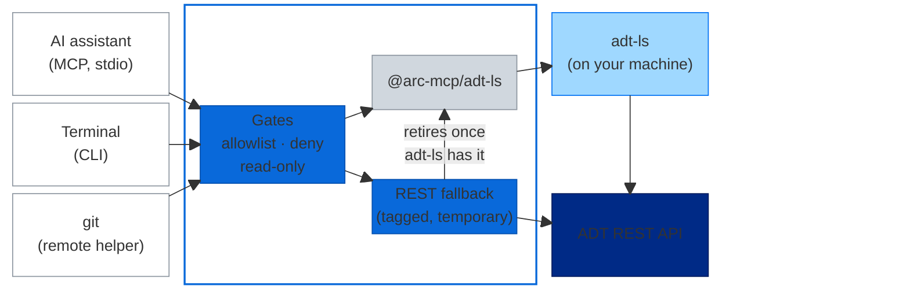

<p align="center">
  <picture>
    <source media="(prefers-color-scheme: dark)" srcset="docs/assets/logo-dark.svg">
    
  </picture>
</p>

<p align="center"><strong>ABAP development from your AI assistant, terminal and git</strong><br>built on SAP's own ADT language server</p>

<p align="center">
  <a href="#why">Why</a> ·
  <a href="#how-it-works">How it works</a> ·
  <a href="#what-it-does">What it does</a> ·
  <a href="#get-started">Get started</a> ·
  <a href="docs/README.md">Docs</a>
</p>

---

> [!WARNING]
> **Work in progress.** adt+ is under active development and depends on adt-ls, the language
> server inside SAP's ADT for VS Code extension. Expect it to break whenever SAP releases a new
> ADT for VS Code, and with it a new adt-ls version, until the SDK and adt+ have been updated to
> match.

adt+ gives AI assistants, the terminal and git read and write access to ABAP systems, on-premise
and in the cloud. It drives adt-ls, the language server inside SAP's ADT for VS Code extension,
through the typed SDK [`arc-mcp/adt-ls`](https://github.com/arc-mcp/adt-ls). A small local daemon
holds the SAP sessions, and every write must target a package on a per-system allowlist.

## Why

SAP ships ADT for VS Code and its
[ADT MCP Server](https://help.sap.com/docs/abap-cloud/abap-development-tools-for-visual-studio-code/enabling-adt-mcp-server?locale=en-US&version=LATEST)
slowly, but ABAP development with AI agents, scripts and git needs these features now. The community has built many
[ABAP MCP servers](https://sap-ai-tools.marianzeis.de/?package=MCP+Server); none combined all of
these:

- **SAP's own language server.** Reads and writes go through adt-ls, which can already do more
  than SAP's tools expose.
- **Public cloud and on-premise, developer access only.** SAP Cloud ERP with browser single
  sign-on, SAP S/4HANA with basic authentication. No admin rights, no service keys, nothing
  installed on the system.
- **AI-assisted, not only agentic.** In VS Code, Copilot edits source through ADT for VS Code's
  `abap://` file system, so you review each change as a diff; adt+ adds what a file system can't.
- **Beyond the IDE.** Terminal agents (Claude Code, Copilot CLI, Codex, OpenCode) get the same
  reads and writes without an editor, and git works on a package directly.

## How it works



$\color{#8c959f}{\square}$ Client &nbsp;
$\color{#0969da}{\blacksquare}$ adt+ &nbsp;
$\color{#d0d7de}{\blacksquare}$ SDK &nbsp;
$\color{#9fd8ff}{\blacksquare}$ ADT for VS Code extension (SAP) &nbsp;
$\color{#002a86}{\blacksquare}$ SAP system

Every client goes through the same daemon and the same gates. The daemon starts on the first
call and holds the SAP sessions while they're in use.

Design principles ([all of them](docs/architecture.md#design-principles)):

- **Built to retire.** adt+ makes usable now what adt-ls can already do, and steps aside once
  SAP ships it in ADT for VS Code or the ADT MCP Server.
- **adt-ls first, REST only where needed.** Where adt-ls lacks a feature, adt+ calls the ADT REST
  API directly. Each such call is tagged in its result and retires once adt-ls can do the same;
  `adtplus system status` shows when it could ([current fallbacks](docs/known-issues.md#rest-fallbacks)).
- **Fix upstream, don't reimplement.** What the SDK lacks goes to `arc-mcp/adt-ls`, and ABAP is
  never parsed by hand: local checks use abaplint.

## What it does

- **Objects:** search, read (also older versions), diff, create, update, activate, delete;
  source objects and, as [AFF](https://github.com/SAP/abap-file-formats) JSON, packages, message
  classes, domains and data elements. RAP generators, service publishing, quick fixes.
- **Code:** where-used, navigation, syntax check, ATC, ABAP Unit with coverage, formatting,
  [abaplint](https://abaplint.org).
- **Transports:** list, find, check, read, diff, create, assign, release.
- **Runtime, opt-in per system:** console classes, data preview, short dumps, gateway errors.
- **Translations (experimental):** an object's translations and translation projects; SAP Cloud
  ERP only, through an SAP UI service that isn't a released API.

Every action and what's missing: [capabilities.md](docs/capabilities.md). Tested on SAP S/4HANA
2023 and SAP Cloud ERP.

### From an AI assistant (MCP)

Up to 14 tools, each in exactly one risk tier (read, write, execute, irreversible), so approving a tool
approves one kind of risk. Registering them per client: [clients.md](docs/clients.md).

> In ZADTPLUS_TEST on S4H, generate a RAP UI service for table ZADTPLUS_BOOKING, activate and
> publish it, run the unit tests and put everything on a new transport.

### From the terminal (CLI)

The same commands under the same names as the MCP tools, for you, your scripts, and agents that
prefer a shell:

```sh
adtplus object read --system S4H --name ZCL_ADTPLUS_BOOKING --type CLAS/OC --method get_total
adtplus transport list --system S4H
```

### With git or a mirror (experimental)

A package or software component as [AFF](https://github.com/SAP/abap-file-formats) files: in real
git through `git-remote-adtplus`, with released transport requests as commits and `git push` on a
transport, or without git as a plain folder (`adtplus_mirror`). Far less live-tested than the rest.

```console
$ git clone -c adtplus.history=transports adtplus::S4H/package/ZADTPLUS_TEST
$ git commit -qam "Rename get_total to calculate_total"
$ git push -o transport=S4HK900231
```

More: [git remote helper](docs/tools/git-remote-helper.md), [mirror](docs/tools/mirror.md).

## Safety

Writes are off until a system names the packages they may touch (`writeAllowlist`); irreversible
actions ask for confirmation; `ADTPLUS_DENY` refuses single commands and `ADTPLUS_READONLY` all
writes, whatever the client's approvals say ([configuration.md](docs/configuration.md)). Point it
at a development system and review what an agent does there.

## Get started

**You need** Node.js 22.15 or later, your own licensed install of SAP's
[ADT for VS Code](https://help.sap.com/docs/abap-cloud/abap-development-tools-for-visual-studio-code)
(adt-ls 1.1.2 or later; adt+ runs its language server and doesn't ship SAP software), and a
developer user on a system you are authorized to use. Tested on macOS only so far: basic-auth
passwords come from the macOS Keychain, and per-project settings ask for approval in a macOS
dialog. Windows and Linux are untested and likely to need work.

```sh
git clone https://github.com/fabianlupa/adtplus.git && cd adtplus
npm install && npm run build && npm link   # puts adtplus and git-remote-adtplus on PATH
```

1. Describe your systems in `~/.config/adtplus/systems.json`
   ([configuration.md](docs/configuration.md#systems)) and check it: `adtplus config validate`.
2. Register the MCP server (stdio, `node <repo>/dist/mcp/server.js`) in your client, with an
   approval per tool: [clients.md](docs/clients.md).
3. Connect: `adtplus system connect --system <id>`.
4. For git, opt the system in with `"mirror": { "git": { "enabled": true } }`
   ([configuration.md](docs/configuration.md#mirror)). Git runs the helper with your shell's
   environment, so set there what the CLI needs too (e.g. `NODE_EXTRA_CA_CERTS`).

## Docs

- [docs/](docs/README.md): architecture, capabilities, configuration, known issues, decisions
- [DEVELOPMENT.md](DEVELOPMENT.md): working on adt+ itself
- [SECURITY.md](SECURITY.md): reporting security issues

## SAP API Policy

adt+ claims no endorsement, certification or approval by SAP and makes no statement about whether
a particular use complies with the [SAP API Policy](https://help.sap.com/doc/sap-api-policy/latest/en-US/API_Policy_latest.pdf).
Whoever operates adt+ against an SAP system is responsible for using it in line with their
agreements with SAP and SAP's documentation, the API Policy included. SAP's
[ADT MCP Server](https://help.sap.com/docs/abap-cloud/abap-development-tools-for-visual-studio-code/enabling-adt-mcp-server?locale=en-US&version=LATEST)
is the SAP-published alternative for what it covers. adt+'s scope under the policy:
[ADR-005](docs/decisions/005-api-policy-scope.md).

## License

[Apache License 2.0](LICENSE). Contributions are accepted under the same license.

SAP, ABAP, SAP S/4HANA and SAP Cloud ERP are trademarks or registered trademarks of SAP SE in
Germany and other countries. adt+ is an independent project, not affiliated with, endorsed or
sponsored by SAP SE; the names are used only to say what adt+ works with. GitHub Copilot is a
trademark of GitHub, Inc.
